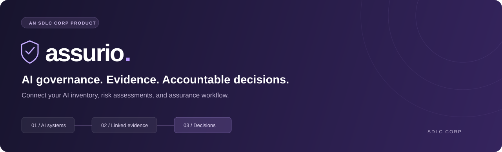
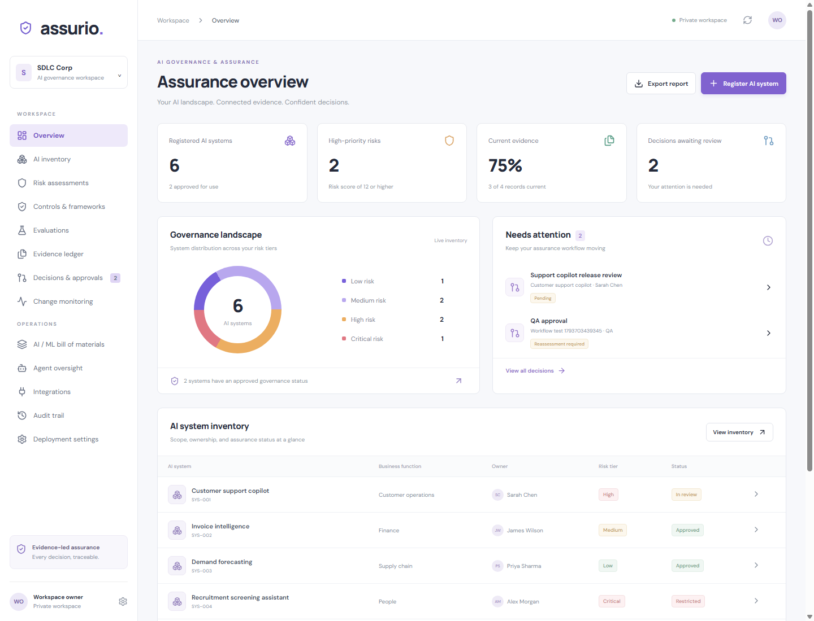
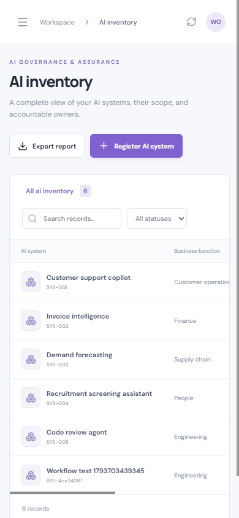
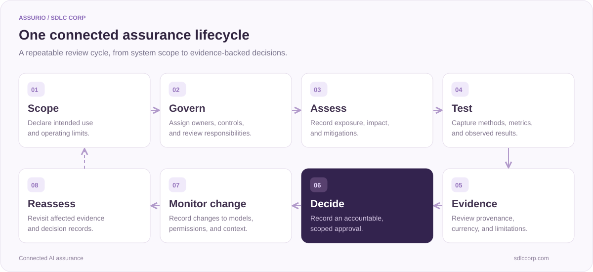
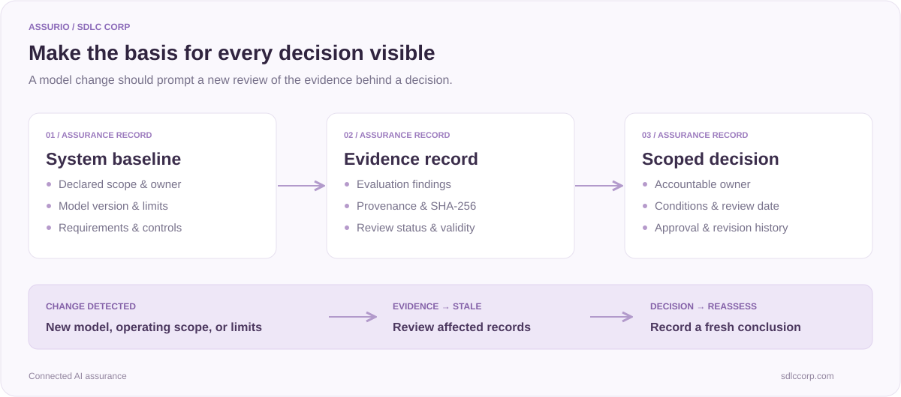
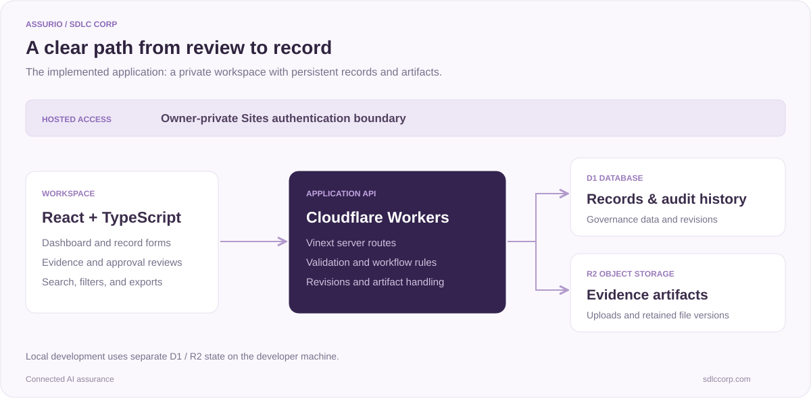

# Assurio · AI Governance & Assurance Platform

**AI inventory. Risk management. Evidence you can trace.**

A connected workspace for AI governance, model oversight, and evidence-backed decisions. 
**A product of [SDLC Corp](https://sdlccorp.com/).**

[Explore the product](https://sdlccorp.com/products/assurio/) · [Quick start](#quick-start) · [Application guide](docs/APPLICATION_GUIDE.md) · [API reference](docs/APPLICATION_GUIDE.md#api-reference)

---

## From AI inventory to accountable decisions

**Assurio is SDLC Corp's AI governance and assurance product.** This repository contains a functional demo application that connects **AI risk management**, **model governance**, evaluation findings, and **evidence management** across the AI lifecycle.

Register an AI system, define its intended use, assess its risks, review evaluation evidence, and record a scoped approval. When the system changes, linked evidence and decisions are flagged for reassessment.

| Know what you operate | Know what supports it | Know when to review it |
| :--- | :--- | :--- |
| An AI system inventory with owners, models, components, and operating limits. | Linked requirements, evaluation results, evidence artifacts, and approval records. | Change-triggered reassessment with a traceable history of revisions. |

> [!NOTE]
> This repository demonstrates working governance workflows with persistent storage. Live connectors, enterprise authorization, and agent runtime enforcement have separate implementation requirements. See [implementation scope](#implementation-scope).

## Inside the workspace

*Actual application screenshot with illustrative sample and local QA records. Figures do not represent customer deployments or production results.*

<strong>View the mobile workspace</strong>

  

## AI governance and assurance capabilities

| Capability | What you can do |
| :--- | :--- |
| **AI system inventory** | Register systems with accountable owners, intended use, models, suppliers, risk tiers, and lifecycle status. |
| **AI risk management** | Assess likelihood and impact, document mitigations, and assign residual risk ownership. |
| **Framework and control mapping** | Connect requirements and acceptance criteria to NIST AI RMF, ISO/IEC 42001, ISO/IEC 23894, EU AI Act, and internal policies. |
| **Model evaluation records** | Capture scenarios, methods, metrics, thresholds, observations, and failed or inconclusive findings. |
| **Evidence management** | Preserve provenance, baselines, validity dates, review status, and controlled revisions. Upload artifacts with SHA-256 fingerprints. |
| **Approval workflows** | Record decision scope, conditions, owners, and review dates with server-side approval checks. |
| **Change-triggered reassessment** | Flag evidence and decisions when models, operating scopes, limits, or recorded change events affect the assurance record. |
| **AI / ML bill of materials** | Document component versions, dependencies, suppliers, hashes, and provenance. |
| **AI agent governance records** | Define agent identities, tool permissions, action boundaries, and human oversight requirements. |
| **Audit trails and reporting** | Inspect record history and export JSON packages for review. |

Framework mappings help organize governance work; they do not establish certification or legal compliance.

## One connected assurance lifecycle

**Example:** A support assistant receives a new model version. Assurio marks its linked evidence stale and flags decisions for reassessment. Reviewers can update the evaluation record, review supporting artifacts, and make a fresh decision within the declared scope.

[Read the workflow rules →](docs/APPLICATION_GUIDE.md#workflow-rules)

## Evidence that stays connected to the decision

The record links a system baseline to its evidence and decision. When a change affects that baseline, the application flags the linked records for review.

## Built for practical governance reviews

- **AI governance teams:** Maintain system ownership, lifecycle controls, framework mappings, and decision records.
- **Model risk and validation teams:** Review evaluation methods, observed results, failed findings, and evidence validity.
- **Engineering teams:** Document model versions, component dependencies, agent boundaries, and changes.
- **Assurance reviewers:** Follow the record from system scope through evidence to a decision and its revision history.

These workflows support responsible AI practices by making scope, human review, and the basis for a decision visible.

## Quick start

**Requires Node.js 22.13+ and npm.** Run these commands from the application directory containing package.json.

~~~bash
npm ci
npm run build
~~~

Initialize a **fresh local database once**:

~~~bash
node --import ./scripts/sites-env.mjs ./node_modules/wrangler/bin/wrangler.js d1 execute DB --local --config dist/server/wrangler.json --persist-to .wrangler/state --file drizzle/0000_nervous_guardian.sql
~~~

Start the application:

~~~bash
npm start
~~~

Open **http://127.0.0.1:8787**. In an empty workspace, choose **Load sample workspace** to explore the connected demo, or **Register AI system** to create your first record.

Already initialized this workspace? Skip the migration step. For source development, use npm run dev and follow the URL printed in the terminal.

[Complete setup instructions →](docs/APPLICATION_GUIDE.md#quick-start) · [First walkthrough →](docs/APPLICATION_GUIDE.md#first-walkthrough) · [Troubleshooting →](docs/APPLICATION_GUIDE.md#troubleshooting)

## Technology and architecture

| Layer | Stack |
| :--- | :--- |
| Interface | React 19 · TypeScript · Lucide icons · Responsive CSS |
| Application | Vinext · Vite · Server-side API routes |
| Runtime | Cloudflare Workers |
| Structured records | Cloudflare D1 · Drizzle schema and migrations |
| Evidence artifacts | Cloudflare R2 · SHA-256 fingerprints |
| Hosted access | Owner-private Sites authentication boundary |

Records and files persist across sessions. Local and hosted storage are separate.

[Architecture and project structure →](docs/APPLICATION_GUIDE.md#architecture)

## Documentation

| Guide | Contents |
| :--- | :--- |
| [Application guide](docs/APPLICATION_GUIDE.md) | Installation, walkthrough, workflow behavior, and development commands. |
| [API reference](docs/APPLICATION_GUIDE.md#api-reference) | Record creation and revision, artifact uploads, responses, and access requirements. |
| [Testing](docs/APPLICATION_GUIDE.md#testing) | Type checking, production builds, API workflow checks, and browser checks. |
| [Deployment and persistence](docs/APPLICATION_GUIDE.md#deployment-and-persistence) | Storage bindings, private hosting, and local/hosted data boundaries. |
| [Implementation limits](docs/APPLICATION_GUIDE.md#current-scope-and-limitations) | Current behavior and capabilities requiring additional implementation. |
| [GitHub publishing guide](docs/GITHUB_PUBLISHING.md) | Suggested repository description, topics, and discoverability settings. |

## Validation

The initial implementation passed TypeScript checks, a production build, **20 API workflow checks**, and desktop/mobile browser checks. This is a recorded validation result, not a live CI status.

~~~bash
npx tsc --noEmit
npm run build
~~~

With the local application running:

~~~bash
node scripts/test-workflows.mjs
~~~

The workflow tests create local QA records and load sample data. Use a test workspace.

## Implementation scope

**Implemented:** Persistent governance records, linked system details, threshold-based evaluation outcomes, evidence uploads and downloads, approval checks, revision history, change-triggered reassessment, search, status filters, and JSON exports.

**Requires additional implementation:** Live external connectors, automated model-test execution, scheduled monitoring, multi-user role/attribute authorization, runtime agent enforcement, cryptographic signing, WORM retention, and offline synchronization.

Deployment profiles and integration entries document requirements; they do not provision infrastructure or activate external services. Approval checks are workflow gates, not a compliance or safety determination.

[Review the complete implementation limits →](docs/APPLICATION_GUIDE.md#current-scope-and-limitations)

---

### Assurio by SDLC Corp

**Connect the system. Preserve the evidence. Make the decision accountable.**

[Product overview](https://sdlccorp.com/products/assurio/) · [SDLC Corp](https://sdlccorp.com/) · [Private hosted workspace — authorized access required](https://assurio-assurance-workspace.ovoidjuice2.chatgpt.site)

Assurio is an SDLC Corp product. Third-party dependencies retain their respective licenses. No open-source license is granted by this README.

