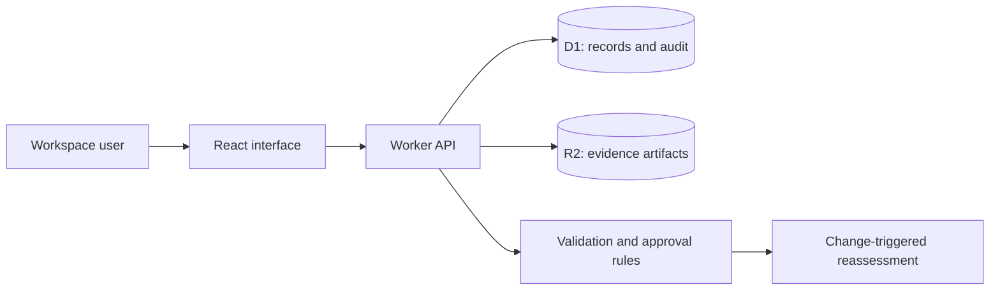

# Assurio application guide

[Back to the product README](../README.md)

Setup, workflows, architecture, and API contracts for the Assurio demo application, an SDLC Corp product.

## Contents

- [Product overview](#product-overview)
- [Features](#features)
- [Quick start](#quick-start)
- [First walkthrough](#first-walkthrough)
- [Workflow rules](#workflow-rules)
- [Architecture](#architecture)
- [Project structure](#project-structure)
- [Development commands](#development-commands)
- [API reference](#api-reference)
- [Testing](#testing)
- [Deployment and persistence](#deployment-and-persistence)
- [Troubleshooting](#troubleshooting)
- [Current scope and limitations](#current-scope-and-limitations)
- [Product attribution](#product-attribution)

## Product overview

AI assurance depends on more than a model score. It also depends on intended use, operating limits, ownership, permissions, evaluation methods, and the evidence supporting a decision.

This application connects those records through a practical lifecycle:

**Scope → Govern → Assess → Test → Evidence → Decide → Monitor change → Reassess**

The dashboard summarizes registered systems, high-priority risks, current evidence, and decisions awaiting review. Individual system records provide access to their linked assurance records.

## Features

| Module | Available functionality |
| --- | --- |
| Assurance overview | Inventory totals, risk distribution, evidence currency, review queue, lifecycle navigation, and recent activity. |
| AI inventory | Register systems with owners, business functions, intended use, risk tiers, models, suppliers, operating limits, and lifecycle status. |
| Risk assessments | Record likelihood, impact, mitigation plans, residual risk, and accountable owners. |
| Controls and frameworks | Map requirements to NIST AI RMF, ISO/IEC 42001, ISO/IEC 23894, EU AI Act, or internal policies; document acceptance criteria and exceptions. |
| Evaluations | Capture methods, scenarios, metrics, thresholds, observed values, findings, and inconclusive results. |
| Evidence ledger | Record provenance, baselines, expiry dates, review status, and controlled revisions; upload and download supporting files. |
| Decisions and approvals | Document decision scope, conditions, owners, and review dates; apply server-side approval gates. |
| Change monitoring | Record model, data, permission, threshold, and environment changes and trigger reassessment. |
| AI / ML bill of materials | Track components, types, versions, suppliers, hashes, dependencies, and provenance. |
| Agent oversight | Document identities, allowed tools, action boundaries, escalation, and human oversight requirements. |
| Integration contracts | Maintain source-system ownership, endpoint URLs, event formats, and failure-handling requirements. |
| Deployment profiles | Document target environments, evidence retention, recovery, synchronization, and access policies. |
| Audit and exports | Review recorded changes and prior values; export workspace and individual-record JSON packages. |

The interface includes search, status filters, linked record details, editable forms, responsive layouts, and optional illustrative sample data.

## Quick start

### Prerequisites

- **Node.js 22.13.0 or later**, with npm.
- Windows PowerShell, macOS, or Linux.
- Network access for the initial dependency installation.
- Git and tar when using the Sites publication workflow.

### 1. Open the application directory

From the parent workspace:

```powershell
cd assurio
```

Run the remaining commands from the assurio application directory containing package.json.

### 2. Install dependencies

```powershell
npm ci
```

### 3. Build the application

```powershell
npm run build
```

The build generates the Worker configuration at dist/server/wrangler.json.

### 4. Initialize the local database

For a **fresh local database**, apply the initial migration once:

```powershell
node --import ./scripts/sites-env.mjs ./node_modules/wrangler/bin/wrangler.js d1 execute DB --local --config dist/server/wrangler.json --persist-to .wrangler/state --file drizzle/0000_nervous_guardian.sql
```

Skip this step if the migration has already been applied. Local initialization does not modify the hosted database.

### 5. Start the application

```powershell
npm start
```

Open **http://127.0.0.1:8787**. Keep the terminal running while using the application; press Ctrl+C to stop it.

For a different local port:

```powershell
npm start -- --port 8788
```

For development with automatic source updates, use:

```powershell
npm run dev
```

Use the URL printed by the development server, normally http://localhost:5173. The production preview started by npm start serves the last build, so rebuild it after source changes.

## First walkthrough

1. Open the dashboard. In an empty workspace, select **Load sample workspace** to explore illustrative systems and their linked records, or select **Register AI system** to start with your own data.
2. Open **AI inventory** and select a system to inspect its scope, owner, status, and connected records.
3. Add a **Risk assessment** and a **Control** for that system.
4. Create an **Evaluation** with a method, metric, minimum acceptable value, and observed result.
5. Create an **Evidence record**, then open its details to upload a supporting artifact.
6. Review the evidence and mark it **Current** with an appropriate validity date.
7. Create a scoped **Decision**. Approval requires the checks described below.
8. Record a **Change event** to see evidence become stale and decisions require reassessment.
9. Review the **Audit trail** or use **Export report** to download a JSON snapshot.

Sample systems, people, and findings are illustrative. Loading samples inserts missing sample IDs without overwriting existing records. Local test runs also create QA records; these are separate from the hosted workspace.

## Workflow rules

### Evaluation scoring

For evaluations submitted as Passed or Failed, the server derives the result using:

```text
observed value >= minimum acceptable value → Passed
observed value < minimum acceptable value  → Failed
```

An observed result is required for either outcome. Planned and Inconclusive evaluations remain explicit states. This implementation supports minimum-value thresholds; lower-is-better metrics require an appropriate transformation or a future comparator extension.

### Approval gates

Approving a system or decision requires:

- At least one linked evidence record marked Current whose validity date has not passed.
- No linked evaluations marked Failed or Inconclusive.
- No linked change events awaiting resolution.

An approved decision must also have a review date that has not passed. These checks operate at the system level; reviewers remain responsible for checking evidence relevance and completeness.

### Reassessment

Changing a system's model, scope, or operating limits, or recording an unresolved change event, marks linked evidence Stale and linked decisions Reassessment required. Affected approved systems return to In review.

Revising evidence or recording a failed or inconclusive evaluation also flags linked approved decisions for reassessment. Resolving a change does not automatically restore approval; evidence and decisions must be reviewed again.

### Evidence files and revisions

- Files must contain at least one byte and may be up to **10 MB**.
- Uploads receive a server-computed **SHA-256 fingerprint**.
- Uploading a new artifact sets the evidence record to Pending review.
- Previous artifacts remain in object storage; the current download endpoint serves the latest attachment.
- Record edits increment the revision number. The API rejects stale revisions so users can refresh before retrying.

## Architecture

| Layer | Technology | Responsibility |
| --- | --- | --- |
| Interface | React 19, TypeScript, Lucide icons, CSS | Dashboard, forms, record details, and responsive navigation. |
| Application framework | Vinext and Vite | React application builds and server routes. |
| Runtime | Cloudflare Workers | Record validation, approval checks, uploads, and API responses. |
| Structured storage | Cloudflare D1 | Governance records, revisions, and audit events. |
| File storage | Cloudflare R2 | Evidence artifacts. |
| Schema and migrations | Drizzle | Versioned database schema definitions and SQL migrations. |
| Hosted access | Owner-private Sites access | Authentication boundary for the shared owner workspace. |



Hosted access is enforced by the private Sites boundary. The local server is intended for a trusted developer machine and binds to loopback. The application does not implement independent multi-tenant membership or enterprise role-based authorization.

## Project structure

```text
assurio/
├── app/
│   ├── page.tsx                  # Application entry page
│   ├── workspace.tsx             # Dashboard, navigation, forms, and details
│   ├── globals.css               # Application styling and responsive layouts
│   ├── layout.tsx                # Root layout and page metadata
│   ├── chatgpt-auth.ts            # Starter authentication helpers
│   └── api/
│       ├── records/route.ts      # Records, validation, approvals, audit
│       └── artifacts/route.ts    # Evidence upload and download
├── lib/
│   ├── modules.ts                # Module fields and input validation
│   └── seed.ts                   # Illustrative sample records
├── db/
│   ├── schema.ts                 # D1 table definitions
│   └── index.ts                  # Drizzle database accessor
├── drizzle/                      # Generated SQL migrations and metadata
├── scripts/
│   ├── test-workflows.mjs        # API integration checks
│   └── browser-qa.mjs            # Desktop/mobile browser checks
├── worker/                       # Production Worker entrypoint
├── .openai/hosting.json           # Site identity and storage bindings
├── vite.config.ts                # Framework and local binding configuration
└── package.json                  # Dependencies and commands
```

Generated builds, local storage, screenshots, and runtime state are ignored by Git.

## Development commands

| Command | Purpose |
| --- | --- |
| npm ci | Install dependencies using the lockfile. |
| npm run dev | Start the source development server. |
| npm run build | Generate the deployable application and Worker configuration. |
| npm start | Run the built application locally. |
| npx tsc --noEmit | Check TypeScript types without generating output. |
| npm run db:generate | Generate migrations after a schema change. |
| node scripts/test-workflows.mjs | Exercise workflows against the running local server. |
| node scripts/browser-qa.mjs | Run browser checks against an existing isolated Chrome DevTools session. |

When changing the schema, inspect generated SQL, apply new migrations locally in order, and commit the migration files and metadata. Preserve previously applied migrations.

## API reference

### Endpoints

| Method | Endpoint | Purpose |
| --- | --- | --- |
| GET | /api/records | Return workspace records and the latest 500 audit events. |
| POST | /api/records | Create or revise a record, or load illustrative samples. |
| POST | /api/artifacts | Upload an evidence artifact using multipart form data. |
| GET | /api/artifacts?id=EVIDENCE_ID | Download the current artifact for an evidence record. |

Supported record kinds are systems, risks, controls, evaluations, evidence, decisions, changes, components, agents, integrations, and settings. Field definitions and accepted statuses are maintained in [lib/modules.ts](../lib/modules.ts).

### Create a system

Send the following JSON to POST /api/records:

```json
{
  "kind": "systems",
  "data": {
    "name": "Support assistant",
    "owner": "AI Operations",
    "domain": "Customer operations",
    "risk": "High",
    "status": "Draft",
    "scope": "Draft support responses for human review.",
    "model": "support-model-v1",
    "supplier": "Internal AI team",
    "limits": "No autonomous customer communications."
  }
}
```

A successful response includes the generated ID:

```json
{
  "ok": true,
  "id": "SYS-example"
}
```

### Revise a record

Supply the existing ID, its latest revision number, and the complete editable data object:

```json
{
  "id": "SYS-example",
  "revision": 1,
  "data": {
    "name": "Support assistant",
    "owner": "AI Operations",
    "domain": "Customer operations",
    "risk": "High",
    "status": "In review",
    "scope": "Draft support responses for human review.",
    "model": "support-model-v2",
    "supplier": "Internal AI team",
    "limits": "No autonomous customer communications."
  }
}
```

Revisions replace editable field values; this is not a partial PATCH operation. Refresh and retry if the server reports a revision conflict.

### Upload evidence

Submit multipart fields:

| Field | Value |
| --- | --- |
| id | Existing evidence-record ID. |
| revision | Current revision number. |
| file | Artifact file, up to 10 MB. |

### Access and errors

Hosted requests must pass the private Site's access boundary. External clients require supported Sites service access; this repository does not provide a public ingestion endpoint or embed service credentials.

Validation failures return an error message. Common response codes include 400 for invalid inputs, 403 for a disallowed origin, 404 for missing records or artifacts, 409 for stale record revisions, and 503 when record storage is unavailable.

## Testing

### Type checking and production build

```powershell
npx tsc --noEmit
npm run build
```

### Workflow integration checks

Start the app in one terminal, then run in another:

```powershell
node scripts/test-workflows.mjs
```

The script performs **20 checks**, covering required fields, approval gates, evaluation scoring, stale revision rejection, change-triggered reassessment, artifact upload/download, fingerprints, origin validation, and audit events.

**The script writes QA records and loads samples into the target database.** Run it against a local test workspace. It defaults to http://127.0.0.1:8787; TEST_URL can select another test server.

### Browser checks

The included browser script expects:

- The application running at http://127.0.0.1:8787 with populated records.
- An isolated Chrome session exposing its DevTools endpoint on port 9223.

It inspects the desktop dashboard, record-form availability, mobile navigation, horizontal overflow, and browser exceptions. Screenshots are written to the ignored outputs directory.

The initial implementation passed the production build, TypeScript checks, 20 workflow checks, and desktop/mobile browser checks. Rerun relevant checks after changing behavior.

## Deployment and persistence

The application is configured for private Sites hosting with these bindings:

```json
{
  "d1": "DB",
  "r2": "BUCKET"
}
```

The actual [.openai/hosting.json](../.openai/hosting.json) also contains the existing project identity. Preserve it when updating this Site.

The publication workflow builds the app, synchronizes its exact source revision, packages the output, and deploys the saved version. Hosted migrations are applied through the Sites deployment workflow.

| Environment | Records and files |
| --- | --- |
| Local | Stored under the ignored .wrangler/state directory. |
| Hosted | Stored in the Site's separately provisioned D1 and R2 resources. |
| Export | JSON snapshots of records and the audit events available to the client. |

Local data is not automatically synchronized to production. JSON exports do not include artifact file contents and are not a complete database-and-object-storage backup. Keep runtime secrets out of source control.

## Troubleshooting

| Symptom | Action |
| --- | --- |
| Database unavailable or missing-table error | Build the app, then apply the pending migration to the local database using the command in Quick start. |
| Table already exists during initialization | The initial migration may already be applied. Inspect local migration state before attempting another application. |
| Port 8787 is in use | Stop the existing server or start with npm start -- --port 8788. |
| Source edits do not appear | npm start serves build output. Rebuild, or use npm run dev for source development. |
| Approval is rejected | Review evidence validity, failed/inconclusive evaluations, pending change events, and the decision's review date. |
| Record changed / revision conflict | Refresh the workspace, reopen the record, and reapply the intended change. |
| File upload fails | Confirm the file is nonempty, no larger than 10 MB, and attached to an existing evidence record with its current revision. |
| Integration does not ingest data | Integration entries are contracts; a live connector must be implemented separately. |
| Hosted records differ from local records | Local and hosted storage are separate by design. |
| Private hosted page requires sign-in | Use the account authorized for the owner-private Site. |

## Current scope and limitations

This repository implements the core connected workflows listed above. The following boundaries remain:

- **External integrations:** Contracts and configuration records are available; live connectors and scheduled telemetry ingestion are not implemented.
- **Agent enforcement:** Permissions and boundaries are governance records. Enforcement must occur in the agent execution environment.
- **Enterprise authorization:** Multi-user role/attribute permissions and multi-tenant membership are not implemented.
- **Deployment modes:** Dedicated, customer-hosted, edge, and disconnected profiles document requirements; they do not provision infrastructure or synchronize offline replicas.
- **Evidence integrity:** SHA-256 fingerprints and retained revisions are available. Cryptographic signing and WORM retention are not implemented.
- **Audit protection:** History is preserved through application workflows, but is not cryptographically immutable against database administrators.
- **Evaluation execution:** The app records supplied observations and derives simple threshold outcomes; it does not execute external model evaluations.
- **Approval coverage:** Checks are based on system-linked evidence rather than exhaustive requirement-level coverage.
- **Time-based review:** Evidence validity is checked for dashboard currency and approval attempts; there is no scheduled process that expires all existing decisions.
- **Exports:** The UI exports the latest 500 audit events returned by the API; older audit events remain stored in D1.
- **Framework mapping:** Mappings and approval statuses do not constitute certification, a legal compliance determination, or proof of AI safety.

## Product attribution

**Assurio is a product of SDLC Corp.** This repository documents the Assurio demo application and its implemented workflows.

For product information and deployment discussions, visit the [official Assurio product page](https://sdlccorp.com/products/assurio/) or [SDLC Corp](https://sdlccorp.com/).

Third-party dependencies remain subject to their respective licenses. This README does not assign an open-source license to the application.

